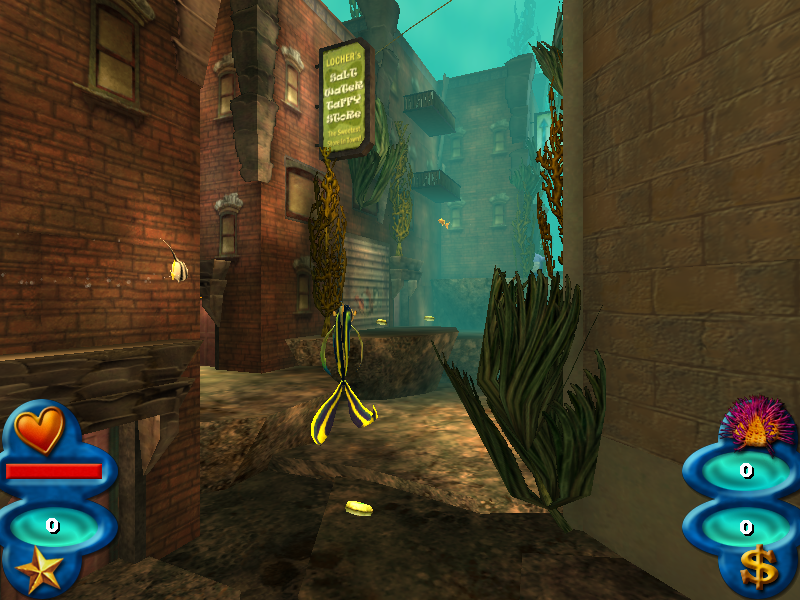

# Shark Tale for macOS (Apple Silicon)

A native Apple Silicon port of **Shark Tale** (PC, 2004, Edge of Reality / Activision), made by **static recompilation**: the game's original 32-bit x86 code is translated to C ahead of time and compiled for arm64. There is no emulator, no Wine and no CrossOver at run time.



**Status: playable.** The intro movies, menus, cutscenes and gameplay all run in a native window or full screen, with Metal graphics, OpenAL sound, music, movies and saving. Gameplay beyond the first level (LowerCity) has not been tested in depth.

> **No game files are included.** You need your own copy of Shark Tale for PC. This repository contains only the translator, the runtime and the build tools.

---

## How it works

Shark Tale runs on Unreal Engine 2, a Windows game made of one EXE and 15 DLLs. The port has two halves.

**1. The translator** (`tools/ghidra_scripts/EmitC.java`). [Ghidra](https://ghidra-sre.org) disassembles each module and lifts it to P-code. EmitC then turns every function into a C function, `F_<address>(Ctx*)`:
- x86 registers live in a context struct.
- Guest memory is a 4 GB block, so the game's 32-bit pointers keep working.
- C++ exceptions and SEH unwind exactly as the game's own tables describe.

The result is about 49,000 functions of generated C, compiled with clang at `-O2`.

**2. The runtime** (`src/Recomp/`) replaces the parts Windows used to provide:

| Windows piece | Replaced by |
|---|---|
| Direct3D 8 (fixed function) | `hle_d3d8_device.c` + `gfx_metal.m`: all 97 device methods on **Metal**, with the fixed-function pipeline as one uber-shader (`gfx_shaders.metal`) |
| DirectInput 8, windows and messages | AppKit events → DirectInput and Win32 messages; a small window manager (`hle_user32.c`, `hle_dinput8.c`) |
| OpenAL (Windows) | bridged to macOS **OpenAL.framework** (`hle_openal.c`) |
| Bink (RAD) | a native Bink **audio** decoder (`bink.c`; all sound effects are Bink audio) and Bink **video** through FFmpeg's libavcodec, loaded at run time (`bink_video.c`) |
| kernel32 / msvcrt / others | files, memory, threads, time and the C runtime, written natively (`hle_*.c`) |

Ogg Vorbis music, Karma physics, UnrealScript and the rest of the engine run as recompiled original code.

`SHARKTALE_NOTES.md` is the full engineering log: findings, every bug found and how it was fixed, and the debug tools.

---

## Requirements

- A Mac with Apple Silicon. Developed on macOS 27 (M5); it should work on macOS 13 or later.
- Xcode Command Line Tools (`clang`).
- Homebrew packages:
  ```bash
  brew install ghidra openjdk@21 ffmpeg
  ```
  `llvm` and `lld` are only needed for the older drop-in-DLL experiments (`tools/build_module.sh`).
- **Shark Tale for PC**, installed. The original binaries this port was built against are listed with their SHA-256 hashes in [`docs/SHA256SUMS`](docs/SHA256SUMS). Check yours against that file: the generated code is specific to those exact binaries.

---

## Setting up the game files

Neither folder below is tracked by git (see `.gitignore`).

| Folder | Contents |
|---|---|
| `orig/System/` | The original `System` folder from an installed copy: `Game.exe`, the DLLs, `.u` packages, `.int` and `.ini` files. These are the binaries Ghidra analyses. |
| `game/` | The game as it runs: a `System/` folder (a copy of the installed one) plus the asset folders `Animations`, `Help`, `Maps`, `Movies`, `Music`, `Sounds`, `StaticMeshes` and `Textures`. These can be copies or symlinks into your installation. |

The game was installed under CrossOver to get these files; any Windows install works too.

**Edit `game/System/Game.ini`** so the game uses the native renderer and audio:
```ini
[Engine.Engine]
RenderDevice=D3DDrv.D3DRenderDevice
AudioDevice=ALAudio.ALAudioSubsystem

[WinDrv.WindowsClient]
WindowedViewportX=1600
WindowedViewportY=1200
FullscreenViewportX=1600
FullscreenViewportY=1200
StartupFullscreen=True
```
The resolution is optional (the original is 800×600). The file uses Windows line endings, so keep them.

---

## Building

### 1. Create the Ghidra project (once)

The build reads a Ghidra project at `ghidra/SharkTale` containing the 16 modules listed in `tools/recomp_layout.txt`:

```
Game.exe Core.dll Fire.dll IpDrv.dll Window.dll WinDrv.dll Engine.dll Editor.dll
D3DDrv.dll ALAudio.dll StubAudio.dll KWGame.dll GUI.dll ogg.dll vorbis.dll vorbisfile.dll
```

1. Import them from `orig/System` with Ghidra's default auto-analysis, using `analyzeHeadless` from `$(brew --prefix ghidra)/libexec/support/`. Analysis takes a few minutes in total.
2. Run these scripts from `tools/ghidra_scripts/` in **saving** mode (not `-readOnly`). They make the program databases complete enough to translate:
   - `FixVarargs.java`
   - `CreateDataReferencedFunctions.java`: functions reached only from data tables
   - `CreateStubTargets.java`: incremental-link `jmp` thunk tables
   - `PropagateThunkNames.java`

> **Caveat:** the project used for this port was built up step by step (see `SHARKTALE_NOTES.md` §5 and §9). A single tested script that recreates it from scratch is not in the repo yet.

### 2. Translate, compile and link

```bash
tools/recomp_build_all.sh
```

This takes about 3–4 minutes on an M-series Mac. The steps:
1. Emit C for every module into `build/recomp/<Module>/` (`tools/recomp_emit_all.sh`).
2. Compile them (`tools/recomp_compile.sh`).
3. Build the runtime and link `build/sharktale` (`tools/recomp_link.sh`).

After changing only runtime code under `src/Recomp/`, `tools/recomp_link.sh` alone is enough (seconds).

### 3. Make the app

```bash
tools/make_app.sh
```

This builds a self-contained **`Shark Tale.app`** (about 890 MB) in the project folder. It contains:
- the executable
- a full copy of `game/` (symlinks resolved)
- FFmpeg's libraries, relinked to load from inside the bundle

The app needs neither Homebrew nor CrossOver afterwards. Move it anywhere you like.

---

## Playing

Double-click `Shark Tale.app`, or run it from a terminal:
```bash
open "Shark Tale.app"
```

- **Full screen** is the default. Toggle with the green window button or Ctrl-Cmd-F.
- **Mouse:**
  - The game captures the mouse while it has focus. **Cmd-Tab** releases it.
  - In a **window**, the mouse is free so you can move and resize the window. **Click** in the game to capture it; press **⌘** to release it.
- **Keys:** the game's normal Windows controls. **Cmd-Q** quits.
- **Saves and settings** are kept in `~/Library/Application Support/Shark Tale/`, never inside the app.
- **Log:** `~/Library/Logs/SharkTaleNative.log`.

You can also run the bare executable from the project folder. It uses `./game/System`:
```bash
build/sharktale
```

---

## Debugging switches

These are environment variables; details are in `SHARKTALE_NOTES.md`.

| Variable | Effect |
|---|---|
| `SHARK_HEADLESS=1` | No window (offscreen rendering) |
| `SHARK_MUTE=1` | Silence audio |
| `SHARK_WINDOWED=1` | Start in a window |
| `SHARK_DUMP=<dir>`, `SHARK_DUMP_EVERY=<n>` | Save every n-th frame as a PNG |
| `SHARK_SCRIPT="<frame>:<action>,…"` | Scripted input: `k<dik>` key, `c<x>/<y>` click, `m<x>/<y>` move, `t` trace draws, `p` screenshot, `x<cmd>` console command, `q` quit |
| `SHARK_TRACE_HLE=1` | Log every Windows API call |
| `SHARK_TRACE_FILES=1` | Log file opens |
| `SHARK_TRACE_DRAWS=<frame>` | Describe one frame's draws |
| `SHARK_TRACE_EH=1` | Log C++ exceptions |
| `SHARK_SELFTEST=1` | Check recompiled maths kernels against C references |
| `SHARK_FPS=1` | Print the frame rate |
| `SHARK_USER_DIR=<dir>` | Where player data goes |

Other tools:
- `tools/bench.sh`: a scripted gameplay benchmark.
- `tools/symbolize.py`: turns guest addresses into `Module!function` names.
- `tools/binkdec.c`: decodes a `.bik` audio track to WAV.

---

## Repository layout

```
src/Recomp/            runtime: memory, dispatch, loader, Win32/DirectX replacements, Metal, audio, Bink
tools/ghidra_scripts/  EmitC (the translator) and Ghidra fix-up/analysis scripts
tools/                 build, app packaging, benchmark and analysis scripts
symbols/               symbol database and per-module function/vtable tables derived from the binaries
docs/                  screenshots, baseline logs, binary hashes
SHARKTALE_NOTES.md     the engineering log
```

## Known issues

- The engine issues each draw call twice (harmless; costs some speed).
- Some actors log "animation sequence not found". This is probably present in the original too, but unconfirmed.
- Levels beyond LowerCity, mini-games and races are untested.
- EAX reverb is not emulated.

## Legal

Shark Tale is © DreamWorks Animation / Activision. This project contains **no game code or assets**; the game files must come from your own legitimate copy. The symbol tables and notes in this repository are derived from analysing the original binaries, so keep it private unless you have reviewed that.

The app built by `tools/make_app.sh` contains the game's data and GPL-licensed FFmpeg libraries. It is for your personal use; do not distribute it.
